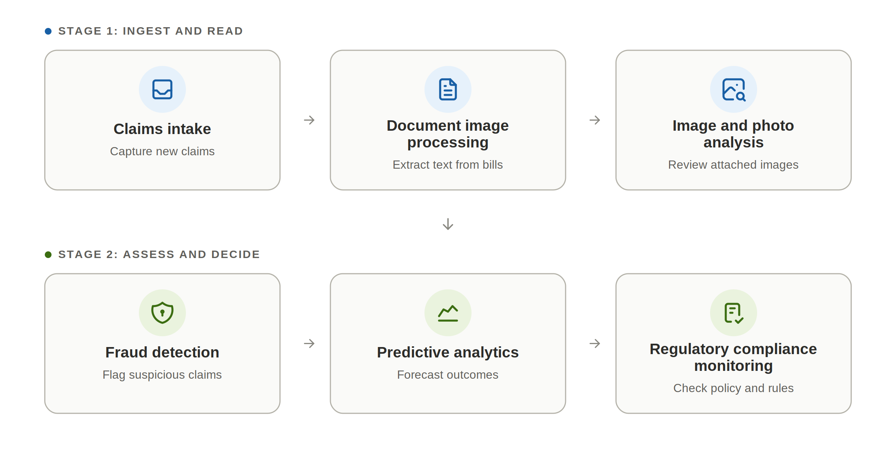
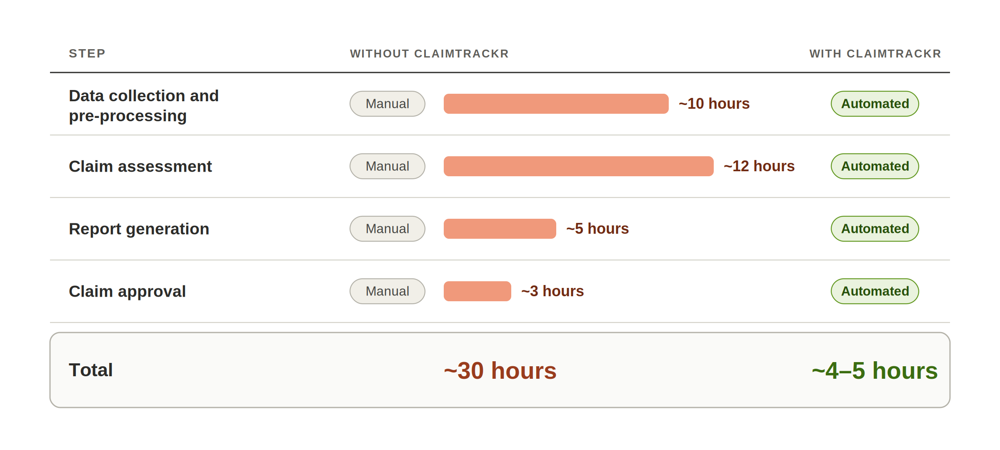
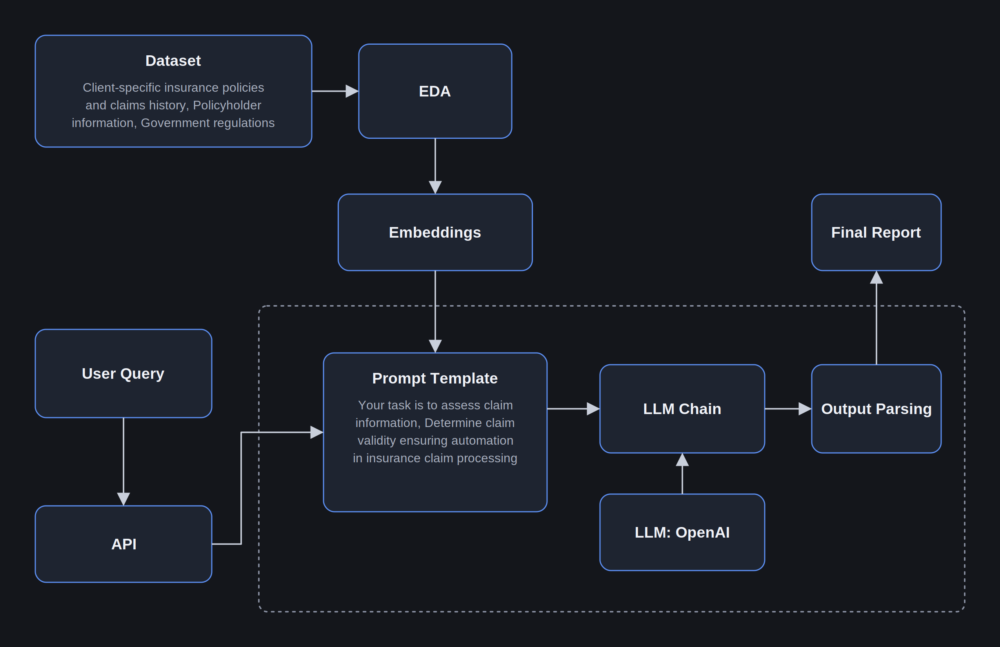

# Claim Tracker: AI-Powered Automated Claims Processing

ClaimTracker is an AI chatbot that automates insurance claim processing. It summarizes each claim, checks it against the policy handbook, and gives a clear verdict on whether the claim is valid.

## Problem

Fast, accurate claim processing matters in finance and insurance. It affects customer satisfaction, operating costs, and regulatory compliance. But claims involve complex rules and large volumes of data, so manual review is slow and error-prone. ClaimTracker automates this work to cut processing time and reduce mistakes.

## What It Does

ClaimTracker combines machine learning, natural language processing, and generative AI to:

- **Summarize claims in real time:** produces an executive summary and states whether the claim is valid.
- **Answer handbook questions:** works as an educational resource on the insurer's membership handbook.
- **Surface insights:** uses AI-driven analysis to improve accuracy, streamline reporting, and support proactive decisions.

## Time Savings

The comparison below shows the time required for each task with and without the ClaimTracker flow.

## Inputs

ClaimTracker needs three sets of inputs:

1. **Insurer documentation:** the medical insurance handbook and supporting documents.
2. **Historical data:** details of previous claims.
3. **Claimant data:** policyholder personal details, medical records, and bills (if any).

## Architecture

### Step 1: Data Collection and Exploratory Data Analysis

ClaimTracker automatically gathers the relevant data: customer records, policyholder information, medical records, external sources, and government data. Once the data is validated, it runs automated exploratory data analysis (EDA) to identify patterns, anomalies, and historical trends that make claim processing more efficient.

### Step 2: Embeddings Generation

Text data is converted into numerical embeddings that capture semantic relationships. This lets ClaimTracker retrieve and compare information quickly, checking each claim against policy terms, medical records, and external data to determine validity and calculate the settlement amount.

### Step 3: Query Execution and Report Generation

When a claim is ready, ClaimTracker uses an OpenAI large language model (LLM) to evaluate its status and generate a detailed report in response to the user's query. The report covers the claim, its assessment, and the proposed settlement. Using the embeddings, the LLM also reviews the claim for potential signs of fraud and provides recommendations.

### Step 4: Parsing and Final Output

The LLM's report is parsed to extract the key insights and organize them into a clear, structured output. This speeds up approval and shortens the time to settlement.

## Demo

## Output Report

Each claim gets a final report with a verdict of **valid** or **rejected**. A claim is rejected if it fails any of these checks:

- **Amount check:** the claimed amount exceeds the allowed amount.
- **Name validation:** the claimant's name doesn't match the policy records.
- **Exclusion check:** the diagnosed condition appears on the handbook's exclusion list.
